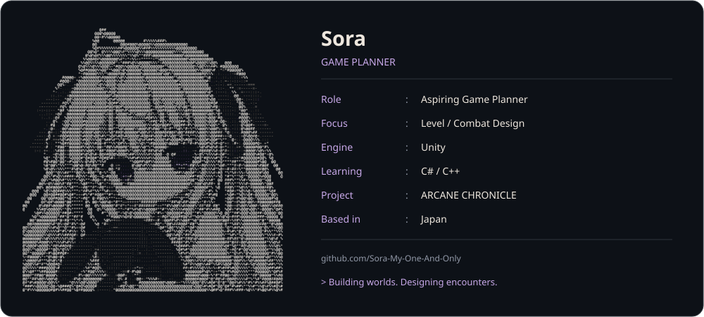

<a href="README.md">日本語</a> · <a href="README.zh-CN.md">中文</a> · <a href="README.en.md">English</a>

<a href="https://github.com/Sora-My-One-And-Only/Portfolio">
  <picture>
    <source media="(prefers-color-scheme: dark)" srcset="assets/profile-en-dark-v4.svg">
    <source media="(prefers-color-scheme: light)" srcset="assets/profile-en-light-v4.svg">
    
  </picture>
</a>

<a href="https://github.com/Sora-My-One-And-Only/Portfolio"><strong>PORTFOLIO</strong></a> &nbsp; / &nbsp; <a href="https://github.com/Sora-My-One-And-Only?tab=repositories"><strong>PROJECTS</strong></a>

An aspiring game planner making games with Unity.  
I focus on level and combat design, refining ideas through playable prototypes.

**In development:** ARCANE CHRONICLE / Lumia’s Adventure  
A 3D action game where command sequences let you chant and cast magic during combat.
