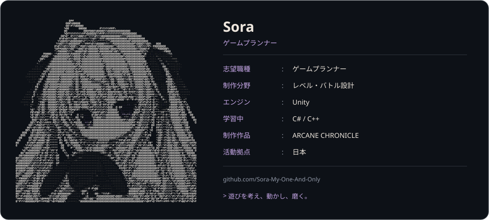

<a href="README.md">日本語</a> · <a href="README.zh-CN.md">中文</a> · <a href="README.en.md">English</a>

<a href="https://github.com/Sora-My-One-And-Only/Portfolio">
  <picture>
    <source media="(prefers-color-scheme: dark)" srcset="assets/profile-ja-dark-v4.svg">
    <source media="(prefers-color-scheme: light)" srcset="assets/profile-ja-light-v4.svg">
    
  </picture>
</a>

<a href="https://github.com/Sora-My-One-And-Only/Portfolio"><strong>作品集</strong></a> &nbsp; / &nbsp; <a href="https://github.com/Sora-My-One-And-Only?tab=repositories"><strong>プロジェクト</strong></a>

ゲームプランナーを目指し、Unityでゲームを制作しています。  
レベルデザインとバトル設計を中心に、遊びのアイデアを実際に動かしながら磨いています。

**制作中：**『ARCANE CHRONICLE / ルミアの冒険譚』  
戦闘中のコマンド入力で魔法を発動する、3Dアクションゲーム。
