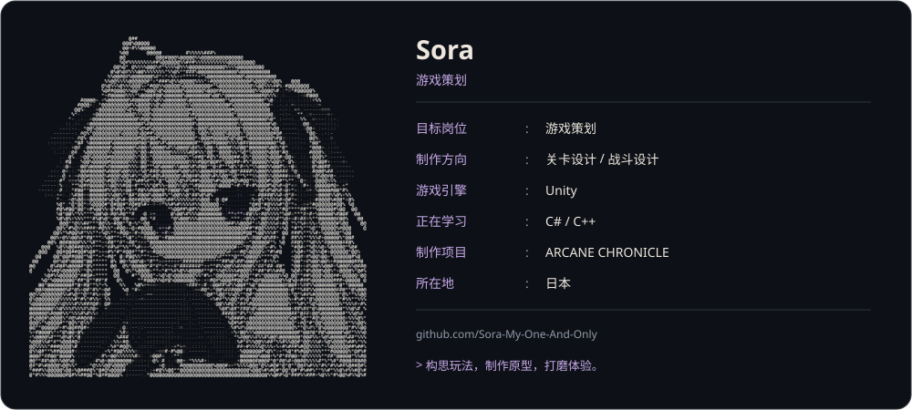

<a href="README.md">日本語</a> · <a href="README.zh-CN.md">中文</a> · <a href="README.en.md">English</a>

<a href="https://github.com/Sora-My-One-And-Only/Portfolio">
  <picture>
    <source media="(prefers-color-scheme: dark)" srcset="assets/profile-zh-dark-v4.svg">
    <source media="(prefers-color-scheme: light)" srcset="assets/profile-zh-light-v4.svg">
    
  </picture>
</a>

<a href="https://github.com/Sora-My-One-And-Only/Portfolio"><strong>作品集</strong></a> &nbsp; / &nbsp; <a href="https://sora-my-one-and-only.github.io/Level-Builder/"><strong>在线体验 Level Builder</strong></a> &nbsp; / &nbsp; <a href="https://github.com/Sora-My-One-And-Only?tab=repositories"><strong>项目</strong></a>

以游戏策划为目标，在日本使用 Unity 制作游戏。  
设计要真正跑起来才能验证：我习惯先做出能玩的原型，再边玩边打磨。

### 专注方向

- **关卡设计** — 从白盒开始，用跳跃轨迹、视野和动线检验空间是否成立
- **战斗设计** — 围绕「在战斗中输入指令释放魔法」设计战斗循环
- **工具制作** — 缺什么工具就自己做：关卡设计工作台、粒子 / 魔法特效编辑器

### 项目

| 项目 | 内容 | 技术 | 状态 |
| --- | --- | --- | --- |
| **ARCANE CHRONICLE** 露米娅的冒险谭 | 在战斗中输入指令、咏唱并释放魔法的 3D 动作游戏 | Unity · C# | 制作中（未公开） |
| **[Level Builder](https://github.com/Sora-My-One-And-Only/Level-Builder)** | 在浏览器中运行的 3D / 2D 白盒关卡设计工作台：三视口联动、视野锥与跳跃抛物线校验、实机漫游测试，可导出 Unity C# / glTF / OBJ，并支持通过 MCP 与 AI 助手协作搭建关卡 | TypeScript · Three.js | 公开 · [在线体验](https://sora-my-one-and-only.github.io/Level-Builder/) |
| **GSParticleStudio** | 粒子编辑器与分层魔法特效运行时，附中 / 日 / 英三语文档 | GLSL | 未公开 |

### 工具

`Unity` `C#` `C++` `TypeScript` `Three.js` `GLSL` `Blender` `Git`
